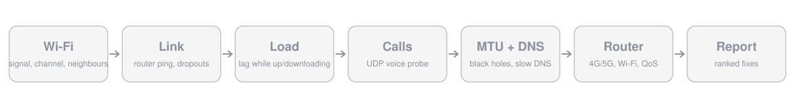

<p align="center">
  <picture>
    <source media="(prefers-color-scheme: dark)" srcset="docs/media/banner-dark.svg">
    
  </picture>
</p>

<p align="center">
  <a href="https://github.com/dav-ayman/network-doctor/actions/workflows/ci.yml"></a>
  
  
  
</p>

**network-doctor** is a [Claude Code](https://claude.com/claude-code) plugin that finds out *why* your internet feels bad, then fixes it at the router, with your approval at every step.

> "My voice keeps breaking in meetings."

Instead of guessing, Claude measures:
- your Wi-Fi;
- latency **while your connection is loaded** (the usual reason calls break);
- call quality on the same UDP path Zoom, Teams and Meet use;
- MTU and DNS.

Then it logs in to your router, reading the password from your OS keychain, to read the cellular signal, Wi-Fi channels and QoS. You get ranked findings with evidence. Fixes are proposed, applied only after you say yes, backed up, and re-measured.

<p align="center">
  
</p>

<p align="center"><a href="docs/media/hero.mp4">▶ Watch the 1-minute overview</a></p>

## Install

In Claude Code:

```
/plugin marketplace add dav-ayman/network-doctor
/plugin install network-doctor@network-doctor
```

Then just describe the problem: *"my calls keep breaking up"*, *"why is my Wi-Fi so slow?"*, *"check my 5G router's signal"*.

There's nothing to `pip install`. It's Python 3.9+ standard library only, and runs on macOS (first class) and Linux.

## What it checks

<p align="center">
  
</p>

| check | how | catches |
|---|---|---|
| Wi-Fi | RSSI, SNR, channel, width, neighbouring networks | weak signal, crowded 2.4 GHz, 40 MHz on 2.4 GHz |
| Local link | router ping at 5/s | Wi-Fi dropouts, retries, bad cables |
| **Latency under load** | call probe idle vs during upload vs during download | **bufferbloat**, graded A+ to F |
| Call quality | UDP STUN at 10 packets/s | loss, jitter, packets too late for voice |
| MTU | DF-ping binary search | PPPoE/VPN black holes |
| DNS | lookup times | slow or failing resolvers |
| Router | vendor API, read-only by default | 4G/5G RSRP/RSRQ/SINR/band, Wi-Fi config, clients, QoS/SQM |

<p align="center">
  
</p>

## Supported routers

| family | covers | tier |
|---|---|---|
| Huawei HiLink | 5G CPE 5s/Pro, B310-B818, E5577/E5785 MiFi, E3372 | ✅ verified |
| ZTE goform | U20, MU5001, MF971 and most ZTE MiFis | ✅ verified |
| ZTE ZXHN | H188A (verified), H298A, F670L and ISP-branded gateways | ✅ verified |
| Huawei home gateway | HG630 V2 (verified), HG633, HG658 | ✅ verified |
| TP-Link Archer | AX/C-series "luci" web UI (signed-AES and RSA logins) | 🧪 experimental |
| TP-Link LTE | Archer MR200/MR600, TL-MR6400/MR6500 | 🧪 experimental |
| TP-Link legacy | older TL-WR / Archer `/userRpm/` UI (read-only) | 🧪 experimental |
| ASUS | ASUSWRT / Asuswrt-Merlin | 🧪 experimental |
| AVM FRITZ!Box | TR-064 | 🧪 experimental |
| MikroTik | RouterOS 7 REST, including LTE monitor | 🧪 experimental |
| OpenWrt | ubus JSON-RPC (LuCI builds), SQM status | 🧪 experimental |

**Verified** means a maintainer tested it on real hardware. **Experimental** means it was written from public protocol documentation and tested against synthetic answers.

Have one of these routers? Run `netdoc.py router detect` and tell us if it works. That's how a family becomes verified. Full list: [docs/support-matrix.md](docs/support-matrix.md).

<p align="center">
  
</p>

**Router not listed?** `netdoc.py capture` saves a masked snapshot of its web API: page title, headers and API paths, with no secrets, MACs, SSIDs or public IPs. Attach it to an [Add my router](https://github.com/dav-ayman/network-doctor/issues/new?template=router-support.yml) issue. Someone can then write a driver without owning the hardware.

## Safety

- **Passwords never touch the chat.** You store them yourself in the macOS Keychain or Linux Secret Service with `netdoc.py secret set <router-ip>`. Output is masked: passwords, keys, tokens, IMEI/ICCID and serials.
- **Passwords stay with their router.** Each stored password is tied to the router's hardware (MAC) address. Lots of networks use the same gateway IP, but your home password is never offered to the café's 192.168.1.1.
- **No lockouts.** Routers lock the admin account after 3-10 wrong passwords. A rejected login is remembered, and netdoc refuses to try again until you fix the password and run `router unblock`.
- **Read-only by default.** Writes show a plan first (current value, then new value). They run only with `--apply` after you approve, save a backup, and come with a one-line revert.
- **TP-Link variants it doesn't recognise:** netdoc stops before sending the password.

## Try it without a router

```
python3 plugins/network-doctor/skills/network-doctor/scripts/netdoc.py diagnose --demo
```

`--demo` runs on a synthetic network: a 5G CPE with bufferbloat and crowded 2.4 GHz Wi-Fi. All the screenshots and videos here come from it.

## CLI

Claude drives the CLI for you. You can also run it directly:

```
netdoc.py diagnose [--quick] [--json]       full checkup with ranked findings
netdoc.py bloat | call [--load up|down]     latency under load / call-quality probe
netdoc.py wifi | link | ping | mtu | dns    individual checks
netdoc.py router detect | status | get | explore | drivers
netdoc.py router write <target> k=v [--apply]   plan, then apply (with backup)
netdoc.py router revert <backup> [--apply]
netdoc.py capture                            masked API snapshot for issues
netdoc.py secret set|check|delete <ip>       keychain (run it yourself)
```

## Contributing

Drivers are single files with fixture tests. See [CONTRIBUTING.md](CONTRIBUTING.md). The most valuable contribution is **confirming an experimental driver on your router**.

## License

MIT. Router vendors' names are used only to describe compatibility. This project isn't affiliated with any vendor.
